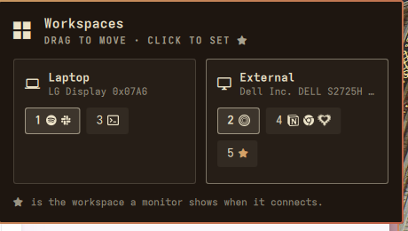

# Workspace Monitors

An [Omarchy](https://omarchy.org) shell plugin for choosing which monitor holds each workspace.



Each connected monitor gets a card holding its workspaces. Every workspace chip shows the workspace number and glyphs for the apps open on it.

- **Drag** a workspace onto another card to move it there. It moves right away, open windows included, and the rule is saved so it stays there from then on.
- **Click** a workspace to give it the ★, making it the workspace that monitor shows when it connects. Each monitor has one.
- The built-in screen is labeled **Laptop** and the others **External**. When an external monitor is unplugged its card disappears, and the panel lists the workspaces that will go back to it when it returns.
- Monitors are identified by their description (`desc:Dell Inc. DELL S2725H …`) rather than by port, so a rule follows the screen, not the cable.

## Install

```bash
omarchy plugin add https://github.com/dror-debug/omarchy-workspace-monitors --enable
```

This puts a grid icon in the bar. Click it to open the panel. You can also search for **Workspace Monitors** in the launcher (Super+Space).

Then make the rules survive a restart by adding this line at the **end** of `~/.config/hypr/hyprland.lua`:

```lua
require("hypr.workspace-monitors")
```

Until that line is there, the panel still moves workspaces but shows a reminder.

### Hotkey (optional)

Add to `~/.config/hypr/bindings.lua`:

```lua
o.bind("SUPER + CTRL + M", "Workspace monitors", "omarchy-shell shell toggle drorko.workspace-monitors")
```

## Your own app glyphs

Common apps such as browsers, terminals, editors, chat apps, Spotify and Notion already have glyphs. To add your own, give the widget's entry in `~/.config/omarchy/shell.json` an `iconRules` list. These rules are checked before the built-in ones:

```json
{
  "id": "drorko.workspace-monitors",
  "iconRules": [
    { "match": "^obsidian$", "glyph": "", "font": "Simple Icons" },
    { "match": "chrome-mail\\.example\\.com", "glyph": "" }
  ]
}
```

- `match` is a regular expression tested against the window class. Use `hyprctl clients -j` to see the classes.
- `glyph` is a character from the bar's Nerd Font. Set `"font": "Simple Icons"` to use the Simple Icons font instead.
- `"heart": true` draws a gear-rimmed heart in place of a glyph.

## How it works

| File | What it is |
| --- | --- |
| `~/.config/omarchy/workspace-monitors.json` | Your rules, the single source of truth |
| `~/.config/hypr/workspace-monitors.lua` | Generated from that file as `hl.workspace_rule` calls; don't edit it by hand |
| `bin/workspace-monitors` | Does all Hyprland and file work: `state`, `set`, `star`, `apply`, `import` |

Each change is applied live with `hyprctl eval` and written to the generated file. Workspaces that already exist are moved with `hl.dsp.workspace.move`.

Keep workspace rules in one place. If another tool, such as OmaSettings, also writes `hl.workspace_rule` for the same workspaces, whichever file loads last wins. Putting the `require` at the end of `hyprland.lua` makes this plugin's rules the ones that apply.

To move rules over from another tool, import them as JSON:

```bash
~/.config/omarchy/plugins/drorko.workspace-monitors/bin/workspace-monitors import \
  '{"1":{"monitor":"desc:Dell Inc. DELL S2725H 29FJM04","default":true},"3":{"monitor":"eDP-1"}}'
```

## Requirements

Omarchy 4 (Quattro shell) with Hyprland's Lua config, plus `jq`. The Simple Icons font is optional and only used by rules that ask for it.

## Uninstall

```bash
omarchy plugin remove drorko.workspace-monitors
rm -f ~/.local/share/applications/workspace-monitors.desktop
```

Then delete the `require("hypr.workspace-monitors")` line from `hyprland.lua`. You can also remove `~/.config/hypr/workspace-monitors.lua` and `~/.config/omarchy/workspace-monitors.json`.

## License

MIT
